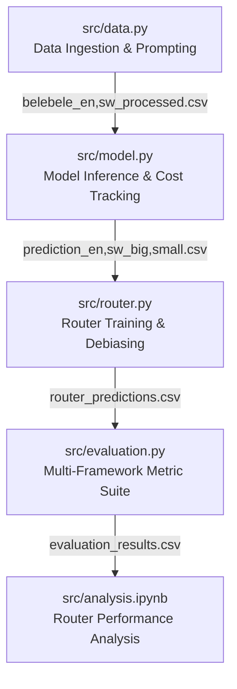

# Lost-in-Routing: Language-Aware LLM Routing

An empirical NLP project investigating whether **language-aware routing** can bridge the performance-cost gap between small (Llama-3.1-8B) and large (Llama-3.1-70B) language models on parallel multilingual reading comprehension (Belebele: English vs. Swahili).

---

## Developer Guide

### Environment Setup

Create and activate the isolated Conda environment:

```bash
# Create environment from specification
conda env create -f environment.yml

# Activate
conda activate router

# To update existing environment dependencies
conda env update -f environment.yml --prune

```


### Quality Assurance & Workflow

Every pull request enforces strict continuous integration (`.github/workflows/ci.yml`):

```bash
# 1. Run unit test suite
pytest

# 2. Linting and formatting checks
ruff check .

# 3. Static type analysis
mypy src/

```

* **Git Conventions:** Branch names follow `feat/<description>` or `fix/<description>`. Commits use Conventional Commits (e.g., `feat(router): add INLP nullspace projection`).


---

## Project Overview

### Motivation & Research Question

Large language models (e.g., Llama-3.1-70B) deliver superior cross-lingual capabilities but incur high computational and monetary costs. Small language models (e.g., Llama-3.1-8B) perform competitively in high-resource languages such as English, but degrade steeply in lower-resource languages such as Swahili.

Query routers act as gatekeepers, dynamically predicting whether an incoming query can be solved by the small model or requires escalation to the large model.

---

### Pipeline Architecture

The experimental pipeline is designed as an end-to-end reproducible flow with strict data isolation:




#### 1. Data Ingestion & Prompting (`src/data.py`)

* Extracts 900 parallel reading comprehension passages with 4-choice questions from `facebook/belebele` for English (eng_Latn) and Swahili (swh_Latn).


* Pairs identical questions across languages via unified `question_id` tags (q_0 to q_899) to guarantee direct cross-lingual comparability.


* Employs language-isolated prompt templates enforcing strict `<answer>X</answer>` outputs for exact-match deterministic grading.


#### 2. Model Inference & Cost Tracking (`src/model.py`)

* **Small Candidate:** `meta-llama/Llama-3.1-8B-Instruct` served locally via an Ollama/vLLM-compatible API.


* **Large Candidate:** `meta-llama/Llama-3.1-70B-Instruct` served via OpenRouter.


* Enforces deterministic decoding (temperature=0) with persistent JSONL caching. Records per-query token counts to compute empirical USD costs.


#### 3. Router Training & Debiasing (`src/router.py`)

* **Oracle Target Labels (y):** A query is labeled y = 1 (needs large model) if and only if the small model fails (small == 0) and the large model succeeds (big == 1). Queries where both fail or the small model succeeds yield y = 0.


* **Feature Representation:** Prompts are stripped of template boilerplate. Passages and questions are separately encoded using `paraphrase-multilingual-MiniLM-L12-v2` (768-d), compressed via PCA to 32 dimensions, and augmented with 4 log-scaled length features (36 features total).


* **Language Scrubbing via INLP:** Multilingual embeddings linearly encode language identity with 99.9% accuracy. We apply `Iterative Nullspace Projection` (INLP; Ravfogel et al., 2020)** to project out language-separating hyperplanes until a linear classifier probe drops to chance level.


* **Router Implementations:**
    * Language-Blind Router: Logistic regression trained strictly on language-scrubbed content features (36-d).


    * Language-Aware Router: Identical logistic regression trained on content features concatenated with standardized one-hot language indicators (38-d).


* **Leakage-Free Nested Cross-Validation:** Uses a 5-fold outer `GroupKFold` grouped on question_id so that parallel language versions of the same question never leak between train and test splits. An inner 5-fold CV tunes L2 regularization (C) and selects the operational threshold theta.


#### 4. Multi-Framework Metric Suite (`src/evaluation.py`)

Combines metrics across four foundational LLM routing benchmarks in Python:

* **LLMRouterBench (Yuli et al., 2025):** Group-balanced accuracy ($\text{AvgAcc}$), relative gain over the Best Single Model ($\text{Gain@B}$), relative gain over random routing ($\text{Gain@R}$), and relative gap to the hindsight oracle ($\text{Gap@O}$).


* **RouterBench (Hu et al., 2024):** 101-point threshold sweep ($\theta \in [0, 1]$), Non-Decreasing Convex Hull ($\text{NDCH}$), Area under the Hull / Average Incremental Quality ($\text{AIQ}$), and head-to-head gap closure ($\text{GapClosed}$).


* **RouterArena & RouterEval:** Optimal Selection Ratio ($\text{OSR}$, share of queries where the cheapest correct model was chosen) and routing distribution entropy ($\text{SelectionEntropy}$).


* **Budget-Constrained Metric:** $\text{Acc@RuleBudget}$ assesses model accuracy interpolated on the convex hull at the exact expenditure of the static language rule ($0.1563).


---

## Experimental Results

### Benchmark Summary

All metrics are evaluated across the 1,800 Belebele queries (900 English, 900 Swahili):

| Routing Strategy | Acc EN | Acc SW | EN–SW Gap (pp) | AvgAcc | Cost (USD) | Cost Saved | Gain@B | Gap@O | GapClosed | Acc@RuleBudget |
| --- | --- | --- | --- | --- | --- | --- | --- | --- | --- | --- |
| `always_small` | 90.8% | 61.3% | 29.4 | 76.06% | $0.0171 | 94.4% | -18.14% | 19.65% | 0.0% | 83.97%* |
| `always_big` | 96.1% | 88.6% | 7.6 | 92.33% | $0.3035 | 0.0% | +0.00% | 1.90% | 0.0% | 83.97%* |
| `language_rule` | 90.8% | 88.6% | 2.2 | 89.67% | $0.1563 | 48.5% | -2.77% | 4.64% | 34.4% | 89.67% |
| `router_blind` | 96.1% | 88.4% | 7.7 | 92.28% | $0.3015 | 0.7% | -0.06% | 1.97% | 9.2% | 85.28% |
| `router_aware` | 95.9% | 88.6% | 7.3 | 92.22% | $0.2929 | 3.5% | -0.12% | 2.02% | **39.7%** | **89.43%** |
| `oracle` | 97.6% | 90.7% | 6.9 | 94.11% | $0.0689 | 77.3% | +1.94% | 0.00% | 100.0% | 94.11% |


---

### Core Scientific Findings

#### 1. The Zero-Regret Operating Dilemma

Under a strict "zero-quality-loss" objective (`choose_threshold`), the router is constrained to match or exceed the accuracy of the 70B model. Because within-language content features provide weak discriminative signal regarding small-model failure, the learned threshold theta is pushed to extreme caution (theta approx. 0.04–0.06). At this operational point, almost all queries (>92% in English, 100% in Swahili) are sent to the large model, saving only 0.7% to 3.5% of total cost.

#### 2. Full-Spectrum Budget Dominance (`GapClosed`)

Decoupling the routers from a single threshold via RouterBench's Non-Decreasing Convex Hull reveals the true value of language conditioning:

* **The Aware Router closes 39.7% of the total quality-cost gap** to the Oracle across all possible operating budgets.


* **The Blind Router closes only 9.2%**, proving that prompt semantics alone cannot reliably route cross-lingual tasks.


#### 3. Heuristic vs. Learned Routing (`Acc@RuleBudget`)

* A static heuristic (`language_rule`: English $\rightarrow$ 8B, Swahili $\rightarrow$ 70B) closes **34.4%** of the gap on its own. Roughly 87% of the Aware Router's efficiency originates from language identity rather than text complexity.


* At the specific spending level of the language rule ($0.1563), the Aware Router achieves **89.43%** accuracy—matching the heuristic (89.67%) without requiring manually hardcoded routing tables. Conversely, the Blind Router falls to **85.28%**, barely outperforming a random mix of candidate models.


---

## Repository Structure

```text
├── docs/
│   ├── development.md            # Development principles
│   ├── literature_review.md      # Summary of relevant literature
│   ├── architecture.md           # Project architecture and main components
│   ├── metrics.md                # Mathematical formalization of evaluation metrics
│   └── project_decisions.md      # Methodological decisions
├── src/
│   ├── data.py                   # Belebele dataset ingestion and preprocessing
│   ├── model.py                  # API/Ollama model inference, exact-match grading, caching
│   ├── router.py                 # Embeddings, INLP debiasing, nested cross-validation
│   ├── evaluation.py             # Metric computation, NDCH construction, threshold sweep
│   ├── analysis.ipynb            # Visualizations, calibration plots, interpretations
│   └── data/                     # Prediction artifacts, CSVs, and embedding cache
└── tests/
    ├── test_data.py              # Test data loading and preprocessing
    └── test_evaluation.py        # Numerical unit tests for metrics
    ├── test_model.py             # Test model inference and caching
    └── test_router.py            # Unit tests for INLP, leakage guards, feature pipelines

```

---

## Citation & References

* **LLMRouterBench:** Yuli et al., 2025. *Benchmarking LLM Routers for Cost-Performance Optimization*.

* **RouterBench:** Hu et al., 2024. *ROUTERBENCH: A Benchmark for Multi-LLM Routing System*. arXiv:2403.12031.


* **INLP:** Ravfogel et al., 2020. *Null It Out: Guarding Protected Attributes by Iterative Nullspace Projection*. ACL 2020.


* **Belebele Benchmark:** Bandarkar et al., 2023. *The Belebele Benchmark: a Parallel Reading Comprehension Dataset in 122 Language Variants*. arXiv:2308.16896.