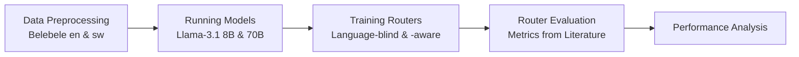
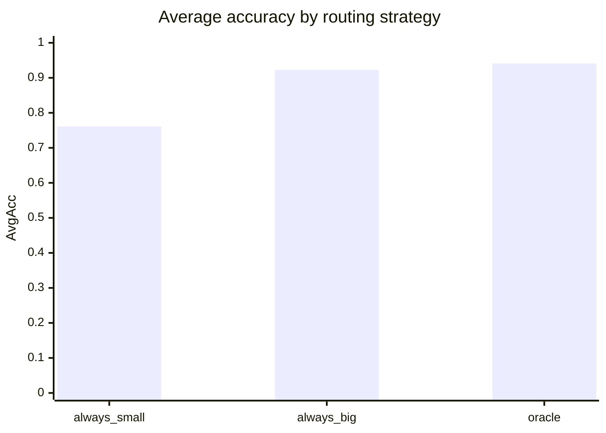

# Lost-in-Routing
Multilingual LLM query routing: evaluating language-aware routers for cost-efficient small-vs-large model selection.

## Prerequisite

Create the Conda environment *once*:
```bash
conda env create -f environment.yml
```

To update the environment, use:
```bash
conda env update -f environment.yml --prune
```

## Setup

Activate the environment:
```bash
conda activate router
```
To deactivate an active environment, use:

```bash
conda deactivate
```

## Workflow

1. Create a branch (e.g. feature/short-description, fix/short-description)

2. Write code + tests

3. Run checks:

```bash
pytest
ruff check .
mypy src/
```

4. Commit (e.g. feat(context): short descrption, fix(context): short description)

5. Push your branch and create a Pull Request.


## Project Overview

### Project Structure
The project is organised as a small, reproducible pipeline:
```text
docs/       # Documentation
notebooks/  # Experiments and analysis
src/        # Project code
|_ data/    # Input and Output Data
tests/      # Unit tests
```

The pipeline for this project looks the following:



### Data Preprocessing
[`src/data.py`](src/data.py) downloads the configured Belebele splits and
turns them into deterministic, language-specific multiple-choice prompts.
English and Swahili keep matching `question_id` values, which makes the
parallel questions directly comparable. The prompts require answers in
`<answer>...</answer>` tags so predictions can be graded with exact matching.
The script writes one processed CSV per language. When combining languages for
router training, the train/test split must be made by `question_id` to keep
parallel versions of a question in the same partition and avoid leakage.

### Running Models
[`src/model.py`](src/model.py) evaluates two models from the same Llama-3.1
family: the local 8B model as the inexpensive candidate and the OpenRouter
70B model as the more capable candidate. Inference is deterministic
(`temperature=0`), and responses are cached in model-specific JSONL files.
For each query, the resulting prediction CSV records the selected answer,
correctness, raw response, and prompt/completion token counts. Those token
counts are later used to estimate inference cost.

### Training Routers
[`src/router.py`](src/router.py) contains the training and execution of two different LLM-routers. One is language-blind, meaning that he doesn't differentiate between english and swahili questions and treats them alike when routing the questions to one of the models. The second LLM-router is language-aware and will include the language into the considerations. Ideally, both routers send easy English
queries to the small model while reserving the large model for queries where
it adds value, particularly in lower-resource languages such as Swahili.

The routers are not implemented yet; the evaluation therefore focuses
on the `always_small`, `always_big`, and hindsight `oracle` baselines instead of evaluating router performance.

### Router Evaluation
[`src/evaluation.py`](src/evaluation.py) will calculate the metrics in order to evaluate router performance once the routers are implemented and executed. 

Currently the evaluation joins the small- and large-model predictions by `question_id` and language, then evaluates a model-selection sequence. It reports average accuracy overall and per language, gain over the best single model (`Gain@B`), distance to the hindsight oracle (`Gap@O`), cost, and the optimal selection ratio. The evaluation also supports threshold
sweeps for cost savings and Pareto analysis, as well as diagnostics such as `Recall@k` and routing entropy. Baselines are calculated from the same per-query correctness and token-based cost matrices, so router comparisons remain consistent.

#### First evaluation snapshot

The first baseline run shows that the large model is more
accurate, while the small model is substantially cheaper. The oracle combines
the strengths of both models and selects the cheapest correct option per query.

<div style="max-width: 600px;">



</div>

| Strategy | AvgAcc | English | Swahili | Gain@B | Gap@O | Cost (USD) | Optimal selection |
|:--|--:|--:|--:|--:|--:|--:|--:|
| `always_small` | 0.761 | 0.908 | 0.613 | -0.181 | 0.197 | 0.0171 | 0.808 |
| `always_big` | 0.923 | 0.961 | 0.886 | +0.000 | 0.019 | 0.3035 | 0.192 |
| `oracle` | 0.941 | 0.976 | 0.907 | +0.019 | 0.000 | 0.0689 | 1.000 |

### Performance Analysis
[`src/analysis.ipynb`](src/analysis.ipynb) is the exploratory layer for
interpreting the results. It will analyse the router performance measured in the evaluation and provide meaningful insights for our research questions.
